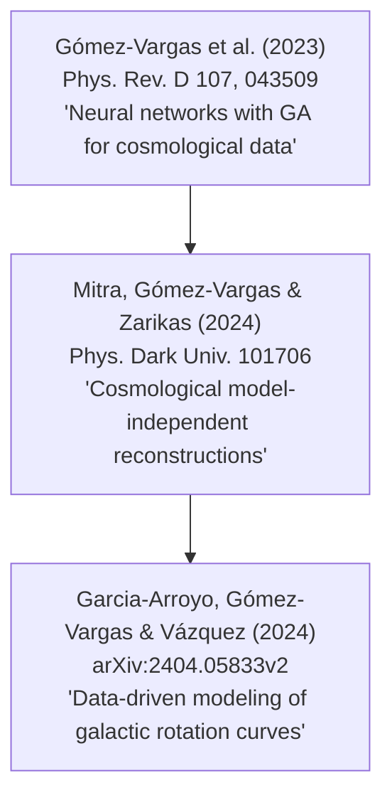

# Theoretical Overview & Methodological Lineage Handout

> **Paper**: *Data-driven modeling of rotation curves with artificial neural networks*  
> **Authors**: Gabriela Garcia-Arroyo, Isidro Gómez-Vargas, J. Alberto Vázquez (arXiv:2404.05833v2)  
> **Prepared for**: Engineering Physics Independent Research & Reproduction  

---

## 1. Executive Summary & Scientific Context

Galactic rotation curves (RCs)—the orbital velocities of matter as a function of radial distance $r$ from the galactic center—provide fundamental empirical evidence for Dark Matter (DM). In standard astrophysics, total circular velocity $V(r)$ is modeled parametrically by summing baryonic and DM halo components:

$$V^2(r) = V_{\text{gas}}^2(r) + \Upsilon_\star V_\star^2(r) + V_{\text{halo}}^2(r)$$

where:
* $V_{\text{gas}}(r)$ is derived from HI $21\,\text{cm}$ surface density profiles (corrected by $1.4\times$ for helium and metals).
* $V_\star(r)$ is derived from $3.6\,\mu\text{m}$ Spitzer surface brightness profiles $I(r)$.
* $\Upsilon_\star$ is the stellar mass-to-light ratio, converting luminosity to gravitational mass.
* $V_{\text{halo}}(r)$ is modeled using a theoretical dark matter profile, such as Navarro-Frenk-White (NFW):

$$\rho_{\text{NFW}}(r) = \frac{\rho_i}{\left(\frac{r}{R_s}\right) \left(1 + \frac{r}{R_s}\right)^2}$$

### The Problem with Parametric Models
Parametric fits make strong prior assumptions:
1. They assume smooth, highly symmetric radial matter distributions.
2. They rely on assumed stellar mass-to-light ratios ($\Upsilon_\star^{\text{fix}}$ from a diet Salpeter IMF or $\Upsilon_\star^{\text{free}}$ fit to data).
3. They fail to capture local density fluctuations, non-circular motions, or irregular baryonic structures (e.g., prominent bulges, spiral arm dynamics).

### The Data-Driven Solution (ANN + MC-DO)
Garcia-Arroyo et al. propose a **non-parametric, data-driven approach** using Artificial Neural Networks (ANNs) with Monte Carlo Dropout (MC-DO) and Genetic Algorithms (GAs). The network learns the functional mapping $r \to [V(r), \sigma_V(r)]$ directly from observational data without imposing physical priors.

---

## 2. Methodological Lineage & Intellectual Context

The machine learning framework in this paper was not developed in isolation. It represents a direct adaptation of a cosmological data reconstruction pipeline established by the same research group:



### Predecessor Papers $\to$ Current Work
1. **Gómez-Vargas et al. (PRD 2023)**: Introduced the combination of Genetic Algorithms (`nnogada` library based on DEAP) and Monte Carlo Dropout for optimizing neural network architectures for cosmological datasets (e.g., $H(z)$ cosmic chronometers, Supernovae Ia).
2. **Mitra et al. (PDU 2024)**: Extended the ANN + MC-DO + GA pipeline to multi-dataset cosmological model-independent reconstructions, validating uncertainty bounds against Gaussian Processes (GP).
3. **Garcia-Arroyo et al. (arXiv:2404.05833v2)**: Applied this validated cosmological pipeline to **galactic dynamics**, replacing redshift $z$ with radial distance $r$, and cosmological observables with rotational velocity $V(r)$ and statistical error $\sigma_V(r)$.

---

## 3. Evolution of the Paper: arXiv v1 vs v2

A detailed comparison between the initial submission (v1, April 2024) and the updated version (v2, Feb 2026) reveals several key structural and narrative refinements:

| Aspect | arXiv v1 | arXiv v2 | Significance |
| :--- | :--- | :--- | :--- |
| **Title** | *Reconstructing rotation curves with artificial neural networks* | *Data-driven modeling of rotation curves with artificial neural networks* | Shifts emphasis from simple "interpolation/reconstruction" to physical "data-driven modeling". |
| **Network Outputs** | Described primarily as velocity prediction | Explicitly clarified multi-output architecture: input $r$, dual coupled outputs $[V(r), \text{error}(r)]$ | Emphasizes that statistical errors are modeled simultaneously with velocity. |
| **LOESS+SIMEX Comparison** | Brief reference to Fernández-Hernández et al. (2019) | Expanded contrast: LOESS is local/piecewise polynomial; ANN learns global non-linear mapping. | Justifies why ANNs are superior for complex non-smooth velocity structures. |
| **Group Interpretations** | Preliminary classification of 17 galaxies | Detailed physical breakdown of Groups A, B, C based on MSE metrics and baryonic vs DM dominance. | Clearer physical insights on where parametric models break down. |

---

## 4. Deep Learning Architecture & Mathematical Formulation

### 4.1 Neural Network Topology
For each galaxy, a dedicated feed-forward neural network is constructed:
* **Input Layer**: $r$ (radial distance in $\text{kpc}$) — 1 neuron.
* **Hidden Layers**: Fully connected layers with $\text{ReLU}(z) = \max(0, z)$ activation functions.
* **Output Layer**: 2 neurons with linear activation functions predicting $[V(r), \sigma_V(r)]$.

```
Input (r) ──> [ Hidden Layer 1 ] ──> [ Hidden Layer 2 ] ──> ... ──> Output [ V(r), error(r) ]
                     │                      │
                (Dropout 0.3)          (Dropout 0.3)
```

### 4.2 Monte Carlo Dropout (MC-DO) for Uncertainty Quantification
Standard neural networks output point estimates without intrinsic epistemic uncertainty. Following Gal & Ghahramani (2016), dropout with rate $p=0.3$ is kept **active during inference (testing)**.

Performing $N_{\text{MC}}$ stochastic forward passes yields a predictive distribution:
$$\hat{V}^{(t)}(r) \sim \text{ForwardPass}(r, \mathbf{W}^{(t)}), \quad t = 1, \dots, N_{\text{MC}}$$

* **Mean Prediction**: $\bar{V}(r) = \frac{1}{N_{\text{MC}}} \sum_{t=1}^{N_{\text{MC}}} \hat{V}^{(t)}(r)$
* **Predictive (Epistemic) Variance**: $\sigma_{\text{MC}}^2(r) = \frac{1}{N_{\text{MC}}} \sum_{t=1}^{N_{\text{MC}}} \left( \hat{V}^{(t)}(r) - \bar{V}(r) \right)^2$
* **Total Uncertainty**: $\sigma_{\text{total}}(r) = \sqrt{\sigma_{\text{MC}}^2(r) + \sigma_{\text{stat}}^2(r)}$

### 4.3 Hyperparameter Optimization via Genetic Algorithms (GA)
To select the optimal network topology for each galaxy without manual tuning, the authors use `nnogada` (DEAP framework) to search over:
* Number of hidden layers $\in [3, 4]$
* Neurons per hidden layer $\in [50, 100, 150, 200]$
* Batch size $\in [4, 8, 16, 32]$

**Fixed Hyperparameters**:
* Optimizer: Adam ($\text{lr} = 5 \times 10^{-4}$)
* Epochs: $1000$
* Dropout rate: $0.3$
* Loss Function: Mean Squared Error ($\text{MSE} = \frac{1}{n}\sum_{i=1}^n (y_i - \hat{y}_i)^2$)

---

## 5. Galaxy Classification & Key Results

The paper classifies 17 THINGS galaxies into three groups based on MSE relative to parametric NFW models:

```
Group A (4 galaxies): Parametric NFW models perform BEST (ANN is worst).
Group B (4 galaxies): ANN outperforms NFW (fixed Y_*), but NFW (free Y_*) is best.
Group C (9 galaxies): ANN outperforms BOTH NFW fixed and NFW free models.
```

### Extracted Table 1 Summary (Selected Galaxies)
| Galaxy | Group | Hidden Layers | Neurons/Layer | Batch Size | ANN MSE | NFW Fix MSE | NFW Free MSE |
| :--- | :---: | :---: | :---: | :---: | :---: | :---: | :---: |
| **DDO154** | A | 4 | 200 | 4 | 3.50 | **2.83** | 2.91 |
| **NGC3621** | A | 4 | 200 | 4 | 22.10 | 12.24 | **10.17** |
| **NGC5055** | B | 4 | 100 | 4 | 124.15 | 239.95 | **42.84** |
| **NGC3521** | C | 3 | 200 | 4 | **62.68** | 335.01 | 225.37 |
| **NGC2976** | C | 4 | 200 | 4 | **3.10** | 25.88 | 11.15 |
| **IC2574** | C | 3 | 200 | 4 | **2.47** | 14.59 | 8.55 |

---

## 6. Key Scientific Takeaways for Reproduction

1. **Non-parametric Flexibility**: In Group C galaxies (especially dwarfs like IC2574, NGC2366, NGC2976), rotation curves display irregular features that standard NFW profiles cannot capture without unphysical parameter values.
2. **Reproducibility Focus**: Our initial single-galaxy reproduction target is **DDO154**, a well-studied DM-dominated dwarf galaxy where parametric models perform slightly better than ANN, serving as an ideal benchmark.
